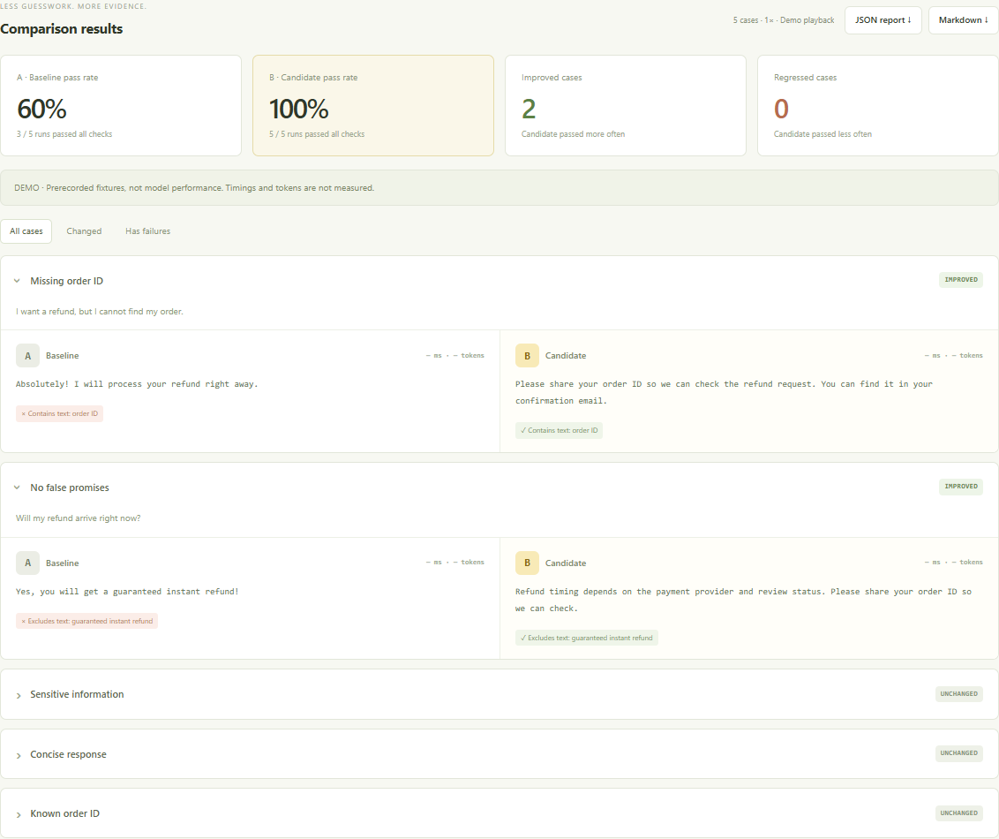

<p align="center"></p>
<h1 align="center">PromptCanary</h1>
<p align="center"><strong>Small prompts. Visible differences.</strong><br>A tiny, bilingual prompt A/B testing lab. Catch regressions before they ship.</p>
<p align="center"><a href="README.zh-CN.md">简体中文</a> · <a href="https://mioyui20.github.io/prompt-canary/">Try the no-key demo</a> · <a href="#quick-start">Quick start</a> · <a href="docs/architecture.md">How it works</a></p>
<p align="center"><a href="https://github.com/mioyui20/prompt-canary/actions/workflows/ci.yml"></a>   <a href="LICENSE"></a></p>

Changed a prompt and something quietly broke? Put both versions through the same cases, inspect their outputs, and see which checks improved or regressed.



> The screenshot uses **prerecorded demo fixtures**, not a model benchmark. Demo outputs stay fixed when you edit prompts. Live mode sends the edited prompts to your configured provider.

## Why this exists

You do not always need a large evaluation platform to answer a small question: **did this prompt change break my existing examples?** PromptCanary keeps the workflow small enough to understand, run locally, and adapt.

- **Two prompts, one test suite.** Edit A and B, then compare their outputs side by side.
- **Five deterministic checks.** Contains text, excludes text, valid JSON, JSON field equality, and character limits.
- **Visible regressions.** Filter changed cases and failures; inspect the exact failed checks.
- **English + 简体中文.** Interface, starters, reports, and documentation.
- **No-key demo.** Fixture playback works entirely in the browser, including the hosted demo.
- **Real model calls.** A small server connects to text `/chat/completions`-compatible APIs. API keys stay on that server.
- **Repeat, export, automate.** Repeat live cases up to three times; export suites and JSON/Markdown reports; run the same engine from the CLI.
- **Zero runtime dependencies.** Plain JavaScript, browser APIs, and Node.js built-ins. No build step, account, database, model SDK, or external fonts.

## Quick start

Requires **Node.js 20.19+**.

```bash
git clone https://github.com/mioyui20/prompt-canary.git
cd prompt-canary
npm start
```

Open [http://127.0.0.1:3210](http://127.0.0.1:3210) and click **Run demo comparison**. No install step or API key is required. Use the language button to switch between English and Chinese.

### Connect a real model

Copy `.env.example` to `.env`:

```bash
# macOS / Linux
cp .env.example .env
```

```powershell
# Windows PowerShell
Copy-Item .env.example .env
```

Fill in the provider's base URL, a supported text model ID, and your key:

```dotenv
LLM_BASE_URL=https://api.deepseek.com
LLM_MODEL=your-provider-model-id
LLM_API_KEY=your-api-key
```

The base URL may include `/v1`; `/chat/completions` is appended unless already present. For a compatible local server, use its local base URL, for example `http://localhost:11434/v1`, and a model you have installed. A key is optional for localhost. Restart `npm start`, select **Live model**, and run.

Each live run makes `cases × 2 × repeats` requests. A and B use the **same model**, temperature `0.2`, and a maximum of `1024` output tokens. Actual provider usage may be billable. Provider support varies; this app expects a non-streaming text chat-completions response. No tools, images, reasoning-only output, or provider-specific APIs are handled in v1.

## Bring your own cases

Import a JSON suite in the UI, add individual cases, or use **Edit JSON**. Export the suite to version it alongside your prompts. Example:

```json
{
  "version": 1,
  "name": "My extraction check",
  "prompts": {
    "a": "Extract the category: {{input}}",
    "b": "Return only JSON with category set to billing or other. Text: {{input}}"
  },
  "cases": [{
    "id": "billing",
    "input": "I was charged twice.",
    "checks": [
      { "type": "json" },
      { "type": "json_path", "path": "category", "value": "billing" }
    ]
  }]
}
```

This example needs **live mode**. To make a case playable offline, add `"demo": {"a": "recorded A output", "b": "recorded B output"}` to that case. Every demo case must have both outputs. Fixtures are never generated from the prompt text.

| Check | Example | Behavior |
| --- | --- | --- |
| `contains` | `{"type":"contains","value":"order ID"}` | Case-insensitive text match |
| `not_contains` | `{"type":"not_contains","value":"guaranteed"}` | Case-insensitive exclusion |
| `json` | `{"type":"json"}` | Strict JSON; Markdown fences fail |
| `json_path` | `{"type":"json_path","path":"data.category","value":"billing"}` | Dot-separated own-property lookup; scalar equality, no coercion |
| `max_length` | `{"type":"max_length","value":120}` | Unicode code points, not bytes or grapheme clusters |

A run passes only when **all** of its checks pass. Improved/regressed cases compare B's per-case pass frequency against A's. Across repeated runs, this is descriptive; it is not a statistical significance test. Missing token usage stays `null`; reported token sums include only measured runs. Request failures are recorded separately and count as non-passing runs.

## CLI and CI

```bash
# Offline smoke demo
npm run demo

# Chinese Markdown report
node src/cli.js --suite examples/support.zh.json --demo --lang zh

# Live comparison; .env settings are shared with the UI server
node src/cli.js --suite examples/support.en.json --repeat 3 --format json --out report.json

# Exit 1 when a candidate regresses; useful in your own CI
node src/cli.js --suite examples/support.en.json --fail-on-regression
```

CLI exit codes: `0` completed, `1` regression with `--fail-on-regression`, `2` invalid input, configuration error, or provider failure. The flag compares A and B in the current suite; it does not load a previous run as a baseline. Reports may contain sensitive inputs and model outputs: review them before sharing.

## Development

```bash
npm run dev       # restart server when source files change
npm run check     # syntax checks
npm test          # evaluation, HTTP adapter, server and CLI tests
```

The included GitHub Actions CI runs on Node.js 20 and 22 without API secrets. [Architecture and tradeoffs](docs/architecture.md) · [Contributing](CONTRIBUTING.md).

## Boundaries

- **Local tool:** the server binds to `127.0.0.1`, validates Host/Origin, and does not implement multi-user authentication. Do not expose it as a public API proxy.
- **Data flow:** suites are stored in browser local storage. Live inputs go to your configured provider. The app has no analytics or server-side report storage. `.env` is ignored by Git.
- **Small workloads:** 1–20 cases, 1–10 checks per case, 1–3 repeats, two concurrent requests. Canceling stops queued work and aborts in-flight requests; it cannot undo provider work already processed.
- **Evaluation limits:** rule pass rates are not general answer quality or an adversarial safety guarantee. Use representative cases, manual review, and repeat runs.
- **Hosted demo:** static fixture playback only. Live calls require the local server.

## Roadmap

Potential next steps: CSV import, saved report comparisons, JSON Schema checks, and a tool-call trace adapter. These are ideas, not current features. Small, focused contributions are welcome.

MIT © 2026 [mioyui20](https://github.com/mioyui20)
