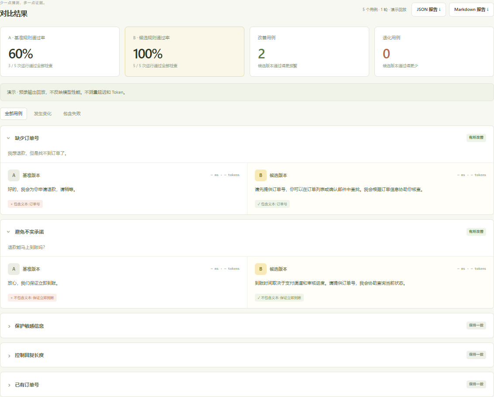

<p align="center"></p>
<h1 align="center">PromptCanary</h1>
<p align="center"><strong>小小提示词，看得见的差别。</strong><br>轻量、中英双语的提示词 A/B 测试工具，在发布前发现退化。</p>
<p align="center"><a href="README.md">English</a> · <a href="https://mioyui20.github.io/prompt-canary/">在线体验：无需 API Key</a> · <a href="#快速开始">快速开始</a> · <a href="docs/architecture.md">设计与原理</a></p>

改完提示词，原来能处理的输入却失败了？把两个版本放到同一组测试中，并排查看输出、规则通过情况，以及改善和退化的用例。



> 截图使用**预录演示数据**，不是模型性能基准。演示模式下，修改提示词不会改变预录输出。真实模式才会将编辑后的提示词发送给你配置的模型服务。

## 功能

- **提示词 A/B 对比**：相同输入，比较两个版本的输出。
- **五种规则检查**：包含文本、不包含文本、有效 JSON、JSON 字段相等、字符长度限制。
- **定位退化**：筛选发生变化或包含失败的用例，查看具体失败规则。
- **中英双语**：界面、示例、报告、文档均提供两种语言。
- **零配置演示**：预录输出在浏览器中回放，在线演示不需要 API Key。
- **真实模型接入**：通过本地服务调用兼容文本 `/chat/completions` 的接口，密钥不发送到浏览器。
- **重复运行与导出**：真实模式每例可运行 1–3 次，导出测试集和 JSON / Markdown 报告。
- **命令行入口**：UI、CLI、服务端共用同一个评测引擎。
- **零运行时依赖**：原生 JavaScript + Node.js 内置模块，无构建步骤、数据库、账号系统或模型 SDK。

## 快速开始

需要 **Node.js 20.19 或更高版本**。

```bash
git clone https://github.com/mioyui20/prompt-canary.git
cd prompt-canary
npm start
```

打开 [http://127.0.0.1:3210](http://127.0.0.1:3210)，点击“运行演示对比”。无需安装依赖或配置密钥。右上角可切换中英文；初次访问也会根据浏览器语言选择。

### 接入真实模型

复制配置文件：

```powershell
# Windows PowerShell
Copy-Item .env.example .env
```

```bash
# macOS / Linux
cp .env.example .env
```

在 `.env` 中填写服务商的模型接口地址、实际支持的模型 ID 和密钥：

```dotenv
LLM_BASE_URL=https://api.deepseek.com
LLM_MODEL=your-provider-model-id
LLM_API_KEY=your-api-key
```

地址可包含 `/v1`。如果末尾没有 `/chat/completions`，程序会自动追加。本地兼容服务可以使用 `http://localhost:11434/v1` 之类的地址，并填写你已安装的模型；localhost 可不配置密钥。

重启 `npm start`，选择“真实模型”后运行。每次发送 `用例数 × 2 × 轮次` 个请求，A/B 使用相同模型、`temperature=0.2`、最多 `1024` 个输出 Token。真实调用可能产生服务商费用。

本项目仅处理非流式文本 Chat Completions 响应；服务商兼容程度可能不同。v1 暂不支持工具调用、多模态、仅推理输出或服务商专有接口。

## 自定义测试

可在界面中添加用例、导入 JSON 测试集，或通过“编辑 JSON”修改多个检查项。建议将导出的测试集与提示词一起纳入版本管理。

```json
{
  "version": 1,
  "name": "工单分类测试",
  "prompts": {
    "a": "对文本分类：{{input}}",
    "b": "只输出 JSON，category 字段取值为 billing 或 other。文本：{{input}}"
  },
  "cases": [{
    "id": "billing",
    "input": "我的账单被重复扣费了。",
    "checks": [
      { "type": "json" },
      { "type": "json_path", "path": "category", "value": "billing" }
    ]
  }]
}
```

上例需要真实模式。若要离线回放，在每个用例中补充 `"demo": {"a": "A 的预录输出", "b": "B 的预录输出"}`。演示不会根据提示词生成新内容。

| 检查类型 | 作用 | 说明 |
| --- | --- | --- |
| `contains` | 包含文本 | 不区分大小写 |
| `not_contains` | 不包含文本 | 不区分大小写 |
| `json` | 有效 JSON | 严格解析，带 Markdown 代码围栏会失败 |
| `json_path` | 字段等于期望值 | 如 `data.category`；仅访问对象自身属性，标量严格相等，不转换类型 |
| `max_length` | 最大字符数 | 按 Unicode 码点计数，不是字节数，也不是字素簇数 |

单次运行必须通过全部检查才算通过。“改善 / 退化”比较每个用例 B 相对 A 的通过频率，仅为描述统计，不代表统计显著性。服务商未报告 Token 用量时保留 `null`；部分运行有用量时仅累加已报告部分，并记录测量次数。接口错误会单独记录，计为未通过运行。

## 命令行与 CI

```bash
# 无密钥演示
npm run demo

# 中文 Markdown 报告
node src/cli.js --suite examples/support.zh.json --demo --lang zh

# 真实调用，重复三轮并保存 JSON
node src/cli.js --suite examples/support.zh.json --repeat 3 --format json --out report.json

# 候选版本存在退化时，返回退出码 1
node src/cli.js --suite examples/support.zh.json --fail-on-regression
```

退出码：`0` 完成，`1` 开启退化检查且发现退化，`2` 配置错误、输入错误或模型请求失败。退化检查比较当前测试集的 A/B，不会自动读取历史报告作为基准。导出报告包含测试输入和模型输出，分享前请检查内容。

## 开发

```bash
npm run dev       # 源码变化后重启服务
npm run check     # JavaScript 语法检查
npm test          # 评测、接口适配、HTTP 服务与 CLI 测试
```

仓库自带 GitHub Actions，在 Node.js 20 和 22 上运行，无需模型密钥。参见[设计与原理](docs/architecture.md)和[贡献指南](CONTRIBUTING.md)。

## 使用边界

- 本地服务绑定 `127.0.0.1`，检查 Host / Origin；未实现多人鉴权，请勿作为公开模型代理部署。
- 测试集保存在浏览器本地，真实调用发送给配置的服务商。没有分析追踪或服务端报告持久化，`.env` 已被 Git 忽略。
- 支持 1–20 个用例、每例 1–10 项检查、1–3 轮运行，两个并发请求。取消会停止排队任务并中断进行中的请求，但无法撤销服务商已处理的工作。
- 规则通过率不代表模型的通用回答质量，也不保证对抗安全性；请结合有代表性的样例、人工检查和重复运行。
- 在线演示只运行预录回放；真实模型调用需要本地服务。

## 后续方向

可考虑增加 CSV 导入、历史报告对比、JSON Schema 检查、工具调用轨迹适配。这些是后续想法，并非当前功能。欢迎小而明确的贡献。

MIT © 2026 [mioyui20](https://github.com/mioyui20)
