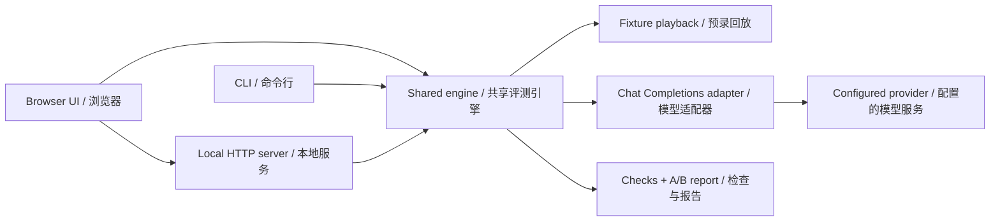

# Architecture / 设计与原理

The app uses one shared evaluation engine in three environments. No build step or framework-specific state is needed.

UI、CLI 和服务端使用同一个评测引擎，不需要构建步骤或框架特定状态。

## Data flow / 数据流

1. Validate and normalize a JSON suite; reject missing checks, duplicate IDs, invalid placeholders and oversized inputs. / 校验 JSON 测试集，拒绝缺失检查、重复 ID、无占位符和超限输入。
2. Create `(case, repeat, variant)` jobs. Two workers consume them, while the result array preserves input order. / 创建“用例、轮次、版本”任务，两个 worker 并发执行，结果保留输入顺序。
3. Demo jobs return stored fixtures. Live jobs render `{{input}}` literally, then call the configured provider. / 演示读取预录输出；真实模式字面替换占位符并调用模型。
4. Check each output with deterministic assertions; a run passes only if every check passes. / 对输出逐项检查，全部通过才算该次运行通过。
5. Aggregate per-variant pass frequencies, measured latency, reported tokens and per-case changes. / 汇总版本通过频率、实测延迟、已报告 Token 和各例变化。
6. Render a report or export JSON/Markdown. / 展示或导出报告。

The API key is loaded from the server environment. There is no field to send keys from the browser, and the browser cannot choose arbitrary upstream URLs. Host/Origin checks and the loopback binding keep the local runner from becoming an unauthenticated internet proxy.

API Key 从服务端环境读取，浏览器没有密钥输入字段，也不能指定任意上游地址。Host / Origin 校验和回环地址绑定使本地工具保持本地使用边界。

## Decisions and limits / 取舍与边界

| Decision / 选择 | Why / 原因 | Tradeoff / 代价 |
| --- | --- | --- |
| Plain JavaScript / 原生 JS | Small learning surface, no build / 易理解，无构建 | Manual rendering and state management / 手动管理状态与渲染 |
| Node.js built-ins / 内置模块 | No runtime dependency chain / 无运行时依赖链 | Small custom server and argument parser / 需要少量服务与参数解析代码 |
| Deterministic checks / 确定性检查 | Reproducible and inspectable / 可复现、可解释 | Cannot measure open-ended quality / 不能衡量开放式质量 |
| Two concurrent calls / 两个并发 | Modest pressure on providers / 控制请求压力 | Not a load-testing system / 不适合压测 |
| One model per comparison / 对比共用模型 | Isolate the prompt change / 尽量隔离提示词变化 | No cross-model comparison in v1 / 暂不支持跨模型对比 |
| Browser local storage / 浏览器本地存储 | No database or account / 无数据库和账户系统 | Draft belongs to this browser / 草稿局限于当前浏览器 |

Repeated pass frequencies are descriptive statistics, not statistical evidence of an improvement. Prompt A/B jobs may be concurrent, so transient provider load can affect timing comparisons. Demo fixtures do not measure model output quality or timing. The v1 scope is single-turn prompt regression, not multi-step agent evaluation.

重复通过频率仅为描述统计，不代表改进具备统计显著性。A/B 请求可能并发，服务商瞬时负载会影响延迟。演示不测量模型质量或耗时。v1 聚焦单轮提示词回归，不包含多步 Agent 评测。

## Testing / 验证

`npm test` covers validation, literal substitution, Unicode handling, repeat aggregation, concurrency, cancellation, error isolation, provider timeouts, HTTP origin boundaries, and CLI outputs. Provider integration tests use a real local HTTP stub; they do not spend money or claim a commercial-provider certification.

`npm test` 覆盖校验、字面替换、Unicode、重复汇总、并发、取消、错误隔离、接口超时、HTTP 来源边界和 CLI 输出。接口集成测试使用真实本地 HTTP 替身，不产生模型费用，也不宣称已认证所有商业服务商。
